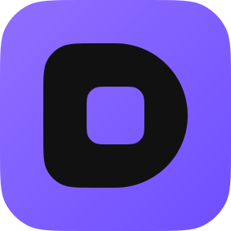

<p align="center"></p>

# Decka

## Download

Get both files from the [latest release](https://github.com/iqonkz/decka/releases/latest). Their names carry the version: `Decka-Setup-<version>.exe` for Windows and `Decka-<version>.apk` for Android.

1. Windows: run `Decka-Setup-<version>.exe`. SmartScreen may warn because the installer is not code-signed: More info → Run anyway.
2. Android: open the release page on the phone, download `Decka-<version>.apk`, allow installing from this source, open it.
3. Scan the QR code shown in the Decka window on the PC.

### Verify the download

Every release carries `SHA256SUMS.txt`. In PowerShell, in the folder with the downloads:

```powershell
Get-FileHash .\Decka-Setup-<version>.exe
Get-FileHash .\Decka-<version>.apk
```

The `Hash` column must equal the hash on the line of the same file in `SHA256SUMS.txt` (case does not matter). If it does not, do not install the file.

## What is Decka

Decka turns an old Android phone into a desk panel for a Windows PC: a 5x3 grid of buttons that launch programs, send hotkeys, open URLs and control media, plus live widgets for PC state, service statuses and webhook notifications. A small agent runs in the Windows tray; the phone shows the panel and only ever tells the agent *which button* was pressed.

<!-- Screenshot: docs/img/hero.png -->

## Why

- **USB mode.** The phone can work over a cable with no Wi-Fi at all, through `adb reverse`. In "USB only" mode the agent listens on `127.0.0.1` and opens no port to your local network.
- **AMOLED burn-in protection.** Pure black background, slow pixel shift, dimming after inactivity, and a screen saver with a wandering clock. A night interval and a "PC offline" screen saver are built in too.
- **Context pages.** The phone opens the right page by itself while a given program is in front on your PC (VS Code, a browser, Zoom) and goes back when you leave it. A "Now playing" widget shows the current track with cover and play/pause/next keys.
- **Webhook-first for developers.** `POST /api/notify` (even a plain-text one-liner with curl) and `POST /api/status` with a TTL give you deploy and AI-session statuses without plugins. Built-in HTTP checks watch your own services.

## Quick start

1. **Install the agent.** Run the NSIS installer from the releases page (or build it, see [Building from source](#building-from-source)). Decka starts in the tray; open the settings window from the tray icon.
2. **Install the app on the phone.** Copy `app-debug.apk` / the release APK to the phone and install it (or `adb install -r app-debug.apk`).
3. **Pair.** In the settings window open **Pairing** and press **Start pairing**; a QR code and an 8-character code appear for 120 seconds. In the app press **Scan QR code**, or type the address and code by hand.
4. Edit buttons in the **Actions** and **Layout** tabs. Changes appear on the phone within a second.

**Pick an installed app and its icon.** In **Actions**, choose the type `Launch a program` and press **Choose installed app…**: the list comes from your Start menu, with search. Picking a program fills the program, its arguments and the working folder. A button that runs such an action takes the program's own icon automatically; in the button's form you can also pick a Lucide icon, an icon from the action's program, or a picture file (png, jpg, ico, bmp). Icons are made on your PC (scaled to 96 px and stored in `%APPDATA%\Decka\icons`); nothing is downloaded and no icons ship with Decka. Microsoft Store apps without a shortcut to an `.exe` are not listed: use **Browse…** or a hotkey for them.

A browser also works for a quick try: open `http://<PC>:9247/` on the phone and paste the pairing details (no camera, no wake lock there).

## Add your first button

1. Open the Decka window on your PC and go to **Layout**.. Click an empty cell, then pick a program, a ready-made action (play, volume, lock) or **Website…** / **Keyboard shortcut…** in the list that opens.. The button is on your phone right away; drag it to move it, right-click it for more. You can also drop a program from Explorer onto a cell.

## Context pages and Now Playing

**Ready-made pages.** In the settings window open **Layout** and press **Add page from template**. Templates for VS Code, a browser, Zoom and Spotify add a page with buttons and their actions in one click. A template needs a big enough grid (the dialog tells you if not) and is added only once per program.

**Your own context pages.** Select a page (not the first one, which is your home page) and, under **Show this page automatically when active**, add the programs by their exe name (`code.exe`; the field suggests programs that have a window open right now). While one of them is in front on the PC, the phone switches to that page, shows its name for a moment, and returns to the page you chose yourself when you leave the program. A touch on the phone postpones the switch by 5 seconds, so it never jumps under your finger. To turn this off, clear **Switch to app pages automatically** in the **Display** block.

**Now Playing.** Add a `media` widget (at least 2×1) and pick the actions for its keys. It reads the system media session of Windows, so it works with Spotify, browsers and most players. The cover is scaled down on the PC (192 px, JPEG) before it is sent.

**Privacy.** Only the exe name of the active program is read and sent to your phone (`code.exe`); window titles are never read. From the media session only the title, artist, album, state, position and cover are taken. Both collectors can be switched off in `config.json`: `"collectors": { "focus": { "enabled": false }, "media": { "enabled": false } }`.

## Looks

Pick the look of the deck in **Appearance**; the phone changes within a second of **Save**. The same screen holds the accent colour, the wallpaper, switching to app pages, and dimming and the screen saver.

- **AMOLED**: a black screen and thin outlines. The default for existing setups.
- **Studio**: a hardware deck with shaded keys, depth and shadow. The default for new installs.
- **Material**: tonal colours generated from your accent colour, with a rounder shape that morphs on press.
- **Glass**: frosted glass over a wallpaper (aurora, sunset, ocean, graphite, or the cover of the current track). If the phone is too slow it drops to a lighter version by itself; **Reduce effects** in the phone menu switches it by hand.

Screenshots will go to `docs/img/theme-amoled.png`, `theme-studio.png`, `theme-material.png` and `theme-glass.png`.

A long press (1.2 s) on an empty spot of the phone screen opens the phone menu: the connection, **Reduce effects**, **Haptics**, **Reload** and **Unpair**. Keys can also give a short vibration; it is on by default and kept per phone.

In **Layout** the preview is the real deck in the chosen look: drag a program, an action or a widget from the left onto a cell, drag keys to move or swap them, drag a corner to resize a widget, and use Ctrl+Z, Ctrl+Y and Ctrl+S. A key can open a popup group (a small panel of related keys) instead of, or after, running its action. For icons, **Phosphor** offers thousands of vector icons in six weights; they take the colour of the key.

## Language

English, 中文（简体）, हिन्दी, Español, العربية, Français, Português (Brasil), Русский, Deutsch, 日本語 and Қазақша, switched in **More → Settings → Language** (and on the first step of the setup guide); **Auto** follows the system language of the window, the phone and Windows, and falls back to English for any other language. Arabic is written right to left in the window and the menus; the grid of keys never mirrors, because the positions of keys are your data.

### Translations

The translations were made by a language model from a fixed glossary (`shared/src/i18n/GLOSSARY.md`); only Russian and Kazakh have been checked by native speakers. To send a correction, open a pull request that changes the text of one key in `shared/src/i18n/<code>.ts` (keep the `{placeholders}` as they are), or the name of a ready-made key, set or template caption in `shared/catalog/i18n/<code>.json`; an issue with the key and the better text is just as welcome. `npm test` checks that every dictionary has every key, the same placeholders, and no empty text.

## Versions

One version number covers the PC agent, the phone app and the APK. It is shown in **More → About** and in the phone menu (`App 0.1.0 · PC 0.1.0`); **Phone** lists the app version of every paired phone. `CHANGELOG.md` lists what changed; once a day (switch it off in **About**) the agent only checks GitHub for a newer release and tells you, it never downloads anything.

## USB mode

1. Install Android platform-tools (`adb`) and put it in `PATH` (or set the path in **Settings**). Decka does not bundle or download adb.
2. On the phone: Settings → About phone → tap *Build number* 7 times; then Developer options → enable **USB debugging**.
3. Connect the cable and accept the "Allow USB debugging?" prompt on the phone.
4. In Decka **Settings** tick **USB mode**. Within about 10 seconds `adb reverse --list` shows `tcp:9247 tcp:9247`; the app connects through `127.0.0.1`.
5. For a cable-only setup choose **USB only (127.0.0.1)** and press **Restart now**.

Do not accept USB debugging prompts on computers you do not own.

## Sending notifications and statuses

Find your API token in the **Integrations** tab.

```powershell
curl.exe -s -X POST http://<PC>:9247/api/notify -H "Authorization: Bearer <TOKEN>" --data-binary "Build finished"
curl.exe -s -X POST http://<PC>:9247/api/status -H "Authorization: Bearer <TOKEN>" -H "Content-Type: application/json" --data-binary "@status.json"
```

More examples (PowerShell, deploy wrapper, Claude Code hooks, GitHub Actions, button state variables) are in [docs/RECIPES.md](docs/RECIPES.md).

## Security model

- The phone sends only an `actionId`. There is no message that carries a command, path, argument, key or URL, and extra fields are ignored.
- Actions live in `actions.json` on the PC; whoever can edit that file can already run code as you.
- Pairing uses a one-time 8-character code (40 bits), valid for 120 seconds, 5 wrong attempts destroy it, 10 attempts per minute per IP.
- The connection between the phone and the PC is encrypted (AES-256-GCM, keys derived per connection) and both sides prove they hold the pairing key, so a device on the same Wi-Fi sees nothing useful and cannot pose as the PC or the phone. Phone and PC must run the same minor version.
- On a public network (Windows says so) the PC serves only the Decka app and pairing is by QR code only; the setting `Allow phones on public networks` can close such connections completely.
- A phone may answer Claude Code questions only if you allow it in the window; a dangerous command needs a one-second hold, and `Always allow` from a phone lasts for one session and at most 8 hours.
- Shutdown, restart, sign out and hibernate from a phone are refused in the first minute after connecting and are limited to one per 30 seconds.
- Notifications of messengers and mail programs are sent to the phone without their text (choose per program in the window).
- Device keys and every password or sign-in token in `config.json` are protected with Windows DPAPI; they are never written to the log.
- Device keys are stored on the PC only under DPAPI and can be revoked one by one; revoked devices are disconnected at once.
- The API token only allows adding notifications, statuses and variables, never running actions. It can be regenerated.
- WebSocket `Origin` is checked against a whitelist, the API needs an `Authorization` header (not a query string), and no CORS headers are sent.
- Rate limits and size limits apply to every endpoint; commands are started without a shell.
- The web client (opened in a browser from the PC's address) uses the same encrypted protocol, but only the QR code or a typed code from a private network can pair it. The installer is not code-signed: check the download as described above.

## Configuration files

Everything lives in `%APPDATA%\Decka`: `config.json`, `actions.json`, `layout.json`, `devices.json`. Formats and limits are described in [docs/DATA_MODEL.md](docs/DATA_MODEL.md); the wire protocol is in [docs/PROTOCOL.md](docs/PROTOCOL.md). Files are watched and reloaded while the agent runs.

## Building from source

Requirements: Node.js 22, stable Rust, Windows; for the APK also Android Studio (SDK + platform-tools), a JDK and `ANDROID_HOME`.

```powershell
npm ci
npm run typecheck; npm test; cargo test -p decka-core
npm run tauri dev        # agent with the settings window
npm run release:agent    # NSIS installer in target\release\bundle\nsis\
npm run release:apk      # client\android\app\build\outputs\apk\debug\app-debug.apk
```

## Troubleshooting

- **The phone cannot reach the PC.** Windows Firewall must allow `decka-agent.exe` on private **and public** networks (a Wi-Fi hotspot, of the PC or of another phone, counts as public: run `netsh advfirewall firewall add rule name="Decka" dir=in action=allow protocol=TCP localport=9247 profile=private,public` as administrator); the phone and PC must be on the same network (guest Wi-Fi and some phone hotspots isolate clients). Try USB mode to rule the network out.
- **`adb unauthorized`.** Unlock the phone and accept the USB debugging prompt; if it does not appear, replug the cable or revoke USB debugging authorizations in Developer options.
- **Port 9247 is busy.** Another program uses it. Change the port in **Settings** and press **Restart now**, or press **Retry** on the Status tab after closing the other program.
- **The phone does not find the PC after the PC slept.** Decka reconnects by itself within about 30 seconds; if the PC hibernates instead of sleeping, network and USB links are down until it wakes. Prefer sleep over hibernation.

## Weather

The weather widget gets its data from [Open-Meteo.com](https://open-meteo.com/) (no key needed). Only the PC asks the internet: the phone never does, and the coordinates are rounded to about 1 km before they are sent. Turn it on in More → Integrations → Weather. Weather data by Open-Meteo.com, licensed [CC BY 4.0](https://creativecommons.org/licenses/by/4.0/); the free service is for non-commercial use.

## Battery and burn-in notes

- A phone that is always charging at 100% ages its battery and, in the worst case, can swell. Power it from a PC USB port (low current) rather than a fast charger, keep it out of direct sun, check the case now and then, and stop using it at once if it bulges. A smart plug on a schedule helps. Decka cannot limit charging without root.
- Pixel shift and dimming slow burn-in but do not remove it; bright static icons can still leave marks. Prefer dark button colors.

## License

MIT, see [LICENSE](LICENSE). Acknowledgements: [NOTICE.md](NOTICE.md).
